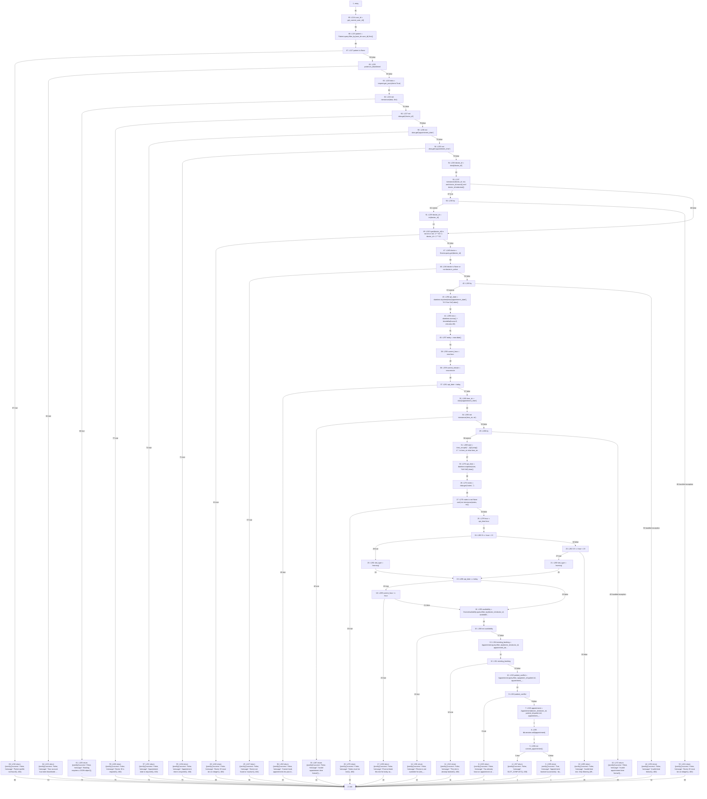

# Booking control-flow graph

`backend/routes/patient.py:213` through line 339. Each explicit return joins one exit. One decision is counted per condition, with an explicit handled-exception edge per handler. Uncaught runtime exceptions and framework decorators are outside the function CFG.

- Concrete graph: E = 91, N = 69, P = 1. M = **24**.
- Short-circuit variant: E = 101, N = 74, P = 1. M = **29**.

