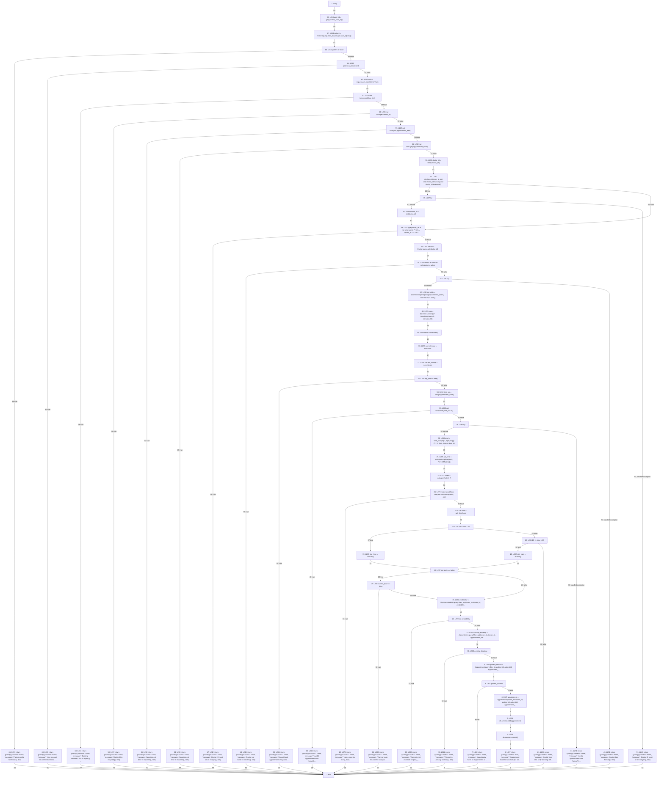

# Booking control-flow graph

`backend/routes/patient.py:212` through line 337. Each explicit return joins one exit. One decision is counted per condition, with an explicit handled-exception edge per handler. Uncaught runtime exceptions and framework decorators are outside the function CFG.

- Concrete graph: E = 89, N = 68, P = 1. M = **23**.
- Short-circuit variant: E = 99, N = 73, P = 1. M = **28**.

